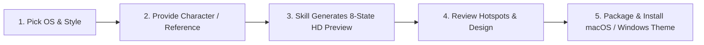

<div align="center">

[简体中文](README.md) · [**English**](README.en.md) · [日本語](README.ja.md) · [한국어](README.ko.md) · [Español](README.es.md)

# 🖱️ Mouse Pointer Theme Maker

### Put your favorite character under your fingertips with custom macOS & Windows pointer themes.

An open-source AI Skill for creators and desktop aesthetics enthusiasts. Turn a mascot, original IP, anime-inspired character, or visual reference into a complete mouse pointer theme for macOS (.cape) and Windows (.cur)—designed state by state, previewed in HD, and packaged only after your explicit approval.


<br/>


<br/>

Ideal for: **desktop personalization, original IP merchandise, custom creator cursors, live-streamer gear, and digital gifts**.

</div>

---

## ✨ Key Features

- 🎨 **3 Distinctive Art Directions**: `retro-pixel`, `chibi-anime`, and `abstract-expression`—integrating characters deeply into functional cursor semantics rather than awkwardly pasting images onto arrows.
- 🎯 **8 Practical Everyday States**: Normal selection, text insertion, link action, unavailable/forbidden, processing/busy, canvas panning, horizontal resizing, and vertical resizing.
- 🖼️ **2440×1388 High-Resolution Preview**: "Preview first, package only after approval." Rendered from 320×320 source artwork with visible red hotspot crosses for complete transparency.
- 💻 **Native Dual-Platform Delivery**:
  - **macOS**: Generates `.cape` packages mapped automatically to 51 system-level cursor identifiers for Mousecape SwiftUI.
  - **Windows**: Generates 15 `.cur` roles with a current-user PowerShell installer (writes only to `HKCU`, no admin permissions required).
- 🔍 **Strict Hotspot & Safe Border Validation**: Hotspots strictly anchored to functional arrow tips, I-beam centers, or fingertips; automatic checks eliminate edge crop residue.

---

## 🎬 Featured Themes Showcase

### 🎮 Kaozai · Retro Pixel

Authentic 16/32-bit pixel reconstruction with sharp silhouettes and crisp color clusters, capturing the mascot's signature sleepy expression.

<div align="center">
  
</div>

### 🐻 Kaomeier · Chibi Anime

A polished Q-version anime character system built around a blue bear hood, expressive reactions, and legible cursor cues.

<div align="center">
  
</div>

### 🎭 Palace Drama · Abstract Expression

Exaggerated poses, visual metaphors, and meme-like comedic timing that bring abstract art to life.

<div align="center">
  
</div>

> 💡 *Note: The red cross in preview sheets marks the true hotspot location and is never included in the installed cursor artwork.*

---

## 🎨 3 Art Directions

| Style Identifier | Description | Visual Characteristics | Best Suited For |
|---|---|---|---|
| `retro-pixel` | **Retro Pixel** | Purpose-built 16/32-bit pixel art, solid 1–2px outlines, sharp color clusters | Game characters, retro mascots, geek culture |
| `chibi-anime` | **Chibi Anime** | Cute Q-version characters, clean linework, expressive faces, cohesive accessories | Anime characters, original mascots, cute illustrations |
| `abstract-expression` | **Abstract Expression** | Exaggeration, visual metaphor, surreal humor, folk-art energy, or meme reactions | Meme characters, dramatic moments, creative visual jokes |

---

## 🎯 8 Practical Functional States

| State Identifier | Function | Visual Focus | Hotspot Location |
|---|---|---|---|
| `normal` | Primary Selection | Standard arrow cue with character behind or adjacent | Top-left arrow tip |
| `text` | Text Insertion | Centered I-beam for accurate character placement | Exact vertical center of I-beam |
| `action` | Link / Button Click | Pointing hand or interactive gesture | Tip of pointing index finger |
| `forbidden` | Unavailable Action | Slash/circle, cross, or defensive character pose | Symbol center or top-left |
| `busy` | Background Processing | Hourglass, spinner, or sleeping/waiting character | Center of mass |
| `open_hand` | Canvas Pan / Drag | Open palm or grabbing posture | Palm center |
| `resize_horizontal` | Left/Right Resize | Bidirectional horizontal arrow | Arrow cross center |
| `resize_vertical` | Up/Down Resize | Bidirectional vertical arrow | Arrow cross center |

---

## 🛠️ Creation Workflow



1. **Pick OS & Style**: Select your platform (macOS or Windows 10/11) and art direction.
2. **Provide Reference**: Supply a character name, mascot description, or reference image.
3. **Review Preview**: Inspect the 2440×1388 PNG sheet showing all eight states with marked hotspots.
4. **Approve Design**: Confirm design and hotspot accuracy, or request revisions.
5. **Install Theme**: Receive your platform-specific package along with a guided tutorial.

---

## 📦 Installation & Quick Start

### 1. Install the Skill

Clone the repository:

```bash
git clone https://github.com/kaomei/mouse-pointer-theme-maker.git
cd mouse-pointer-theme-maker
```

Copy into your skills directory:

```bash
# Codex
cp -R . "${CODEX_HOME:-$HOME/.codex}/skills/mouse-pointer-theme-maker"

# Antigravity / Gemini CLI
cp -R . ~/.gemini/config/skills/mouse_pointer_theme_maker
```

### 2. Invoke in Conversation

Restart Codex or your AI assistant and try:

```text
Use $mouse-pointer-theme-maker.
Computer: macOS
Style: retro-pixel
Theme: Turn my blue mascot reference into a complete pointer theme.
```

---

## 💻 Platform Delivery Details

### 🍏 macOS Delivery
- **Package Format**: Delivered as a `.cape` theme bundle.
- **Application Tool**: Import and apply via [Mousecape SwiftUI Releases](https://github.com/sdmj76/Mousecape-swiftUI/releases).
- **System Coverage**: The 8 original artworks expand automatically to 51 macOS system cursor identifiers.

### 🪟 Windows Delivery
- **Package Format**: Delivered as 15 `.cur` files with 64/96/128 runtime size installers and `restore-default.ps1`.
- **Installation**: Right-click `install-current-user-小.ps1`, `install-current-user-中.ps1`, or `install-current-user-大.ps1` and select **Run with PowerShell**. The selected size applies immediately and is reapplied at every logon.
- **Safety**: Modifies only current-user cursor values and the current-user logon entry, without administrator privileges.

---

## 🛡️ Quality Guarantees

- 🔍 **Ultra-High Resolution**: 2440×1388+ preview sheets rendered from 320×320 source assets.
- 🎯 **Pixel-Accurate Hotspots**: Every state undergoes coordinate verification.
- 🧼 **Safe Transparent Borders**: Automated inspection rejects clipped artwork and residue lines.
- 🔒 **Privacy First**: Reference imagery and generated installation archives stay excluded from public repositories.

---

## 📁 Repository Structure

```text
mouse-pointer-theme-maker/
├── agents/       # Codex UI metadata
├── assets/       # Manifest template and cover assets
├── examples/     # Curated high-resolution theme previews
├── references/   # Style, state, platform, and installation guides
├── scripts/      # Preview, package, validation, and conversion tools
├── tests/        # Contract and unit test suite
└── SKILL.md      # Skill workflow definition
```

---

## ⚠️ Disclaimer & Copyright Notice

1. **Non-Official Project**: `mouse-pointer-theme-maker` is an open-source AI prompt engineering and asset creation tool. **It has no commercial affiliation, sponsorship, or official endorsement from any animation, gaming, or entertainment companies**.
2. **Intellectual Property**: All character names, images, and derivative concepts referenced in examples belong to their respective copyright and trademark owners.
3. **Intended Use**: This Skill is provided for personal learning, technical research, AI generative art exploration, and **non-commercial personal desktop customization**. Do not use copyrighted character assets for commercial distribution.

---

## 🤝 Contributing

Contributions, new theme showcases, and suggestions are welcome!

Please verify tests before submitting PRs:

```bash
python3 -m unittest discover -s tests -v
```

If this tool helped you customize your desktop, **please give this repository a ⭐️ Star!**

---

## 📄 License

MIT License © 2026 [kaomei](https://github.com/kaomei). Example character artwork remains subject to the rights of its respective creators.
