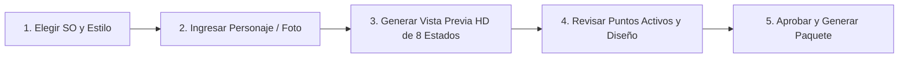

<div align="center">

[简体中文](README.md) · [English](README.en.md) · [日本語](README.ja.md) · [한국어](README.ko.md) · [**Español**](README.es.md)

# 🖱️ Mouse Pointer Theme Maker (Creador de Temas de Punteros de Ratón)

### Pon a tu personaje favorito bajo tus dedos. Crea temas de cursores de alta calidad para macOS y Windows con IA.

Un Skill de IA de código abierto para creadores y entusiastas de la personalización de escritorio. Convierte un personaje, mascota o imagen de referencia en un tema completo de cursores en 3 estilos artísticos y 8 estados funcionales cotidianos con entrega nativa en macOS (.cape) y Windows (.cur).


<br/>


<br/>

Ideal para: **personalización de escritorio, productos de personajes/IPs, cursores para streamers y regalos digitales especiales**.

</div>

---

## ✨ Características Principales

- 🎨 **3 Estilos Artísticos Únicos**: `retro-pixel` (pixel art retro), `chibi-anime` (anime chibi) y `abstract-expression` (expresión abstracta).
- 🎯 **8 Estados Funcionales Cotidianos**: Selección normal, entrada de texto, clic de enlace, no disponible/prohibido, ocupado/procesando, mover lienzo, ajuste horizontal y ajuste vertical.
- 🖼️ **Vista Previa de Ultra Alta Definición 2440×1388**: "Previsualizar primero, empaquetar solo tras aprobación". Renderizado desde fuentes 320×320 con cruces rojas que indican los puntos activos (Hotspot).
- 💻 **Entrega Nativa Dual macOS y Windows**:
  - **macOS**: Paquetes `.cape` compatibles con Mousecape SwiftUI (mapeo inteligente a 51 identificadores del sistema).
  - **Windows**: 15 archivos `.cur` estándar con scripts PowerShell de instalación y restauración sin permisos de administrador.

---

## 🎬 Galería de Temas (Theme Showcase)

### 🎮 Kaozai · Pixel Retro (Retro Pixel)
<div align="center">
  
</div>

### 🐻 Kaomeier · Anime Chibi (Chibi Anime)
<div align="center">
  
</div>

### 🎭 Drama de Palacio · Expresión Abstracta (Abstract Expression)
<div align="center">
  
</div>

---

## 🛠️ Flujo de Trabajo



---

## 📦 Instalación y Uso

```bash
git clone https://github.com/kaomei/mouse-pointer-theme-maker.git
cd mouse-pointer-theme-maker

# Codex
cp -R . "${CODEX_HOME:-$HOME/.codex}/skills/mouse-pointer-theme-maker"

# Antigravity / Gemini CLI
cp -R . ~/.gemini/config/skills/mouse_pointer_theme_maker
```

---

## ⚠️ Aviso Legal y Derechos de PI (Disclaimer)

1. **Proyecto No Oficial**: Este proyecto es una herramienta de ingeniería de prompts y no tiene afiliación con las empresas mencionadas.
2. **Propiedad Intelectual**: Los derechos de los personajes pertenecen a sus respectivos autores.
3. **Uso Permitido**: Para fines de aprendizaje personal, investigación y personalización no comercial.

---

## 🤝 Contribuciones

¡Las solicitudes de extracción (PR) y sugerencias son bienvenidas!

Si este proyecto te ha sido útil, **¡dale una ⭐️ Star para apoyar a kaomei (烤妹儿)!**

## 📄 Licencia

[MIT License](LICENSE) © 2026 [kaomei](https://github.com/kaomei)
