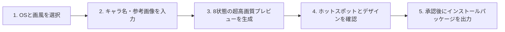

<div align="center">

[简体中文](README.md) · [English](README.en.md) · [**日本語**](README.ja.md) · [한국어](README.ko.md) · [Español](README.es.md)

# 🖱️ Mouse Pointer Theme Maker (マウスポインターテーマ作成器)

### 推しキャラを指先に。AI で macOS / Windows 向けの高クオリティなカスタムカーソルを一発制作。

クリエイターやデスクトップカスタマイズ愛好家のためのオープンソース AI Skill。キャラクター名、オリジナルマスコット、または参考画像を入力するだけで、3大アートスタイル・実用的な8大機能状態の高解像度マウスポインターテーマを生成。macOS (.cape) および Windows (.cur) のネイティブ形式で納品します。


<br/>


<br/>

適用シーン：**デスクトップ美化、二次元・オリジナルキャラクターグッズ、配信者・VTuber専用カーソル、デジタルギフト**。

</div>

---

## ✨ 主な特徴

- 🎨 **3つの独自アートスタイル**：`retro-pixel`（レトロピクセル）、`chibi-anime`（ちびアニメ）、`abstract-expression`（アブストラクト表現）。
- 🎯 **日常で使う8大機能状態を網羅**：通常選択、テキスト入力、リンククリック、操作不可、処理中、キャンバス移動、左右リサイズ、上下リサイズ。
- 🖼️ **2440×1388 超高解像度プレビュー**：「プレビューを確認し、満足してからパッケージ化」の原則。320×320 ソース素材からレンダリングし、赤い十字でホットスポット（Hotspot）を明示。
- 💻 **macOS & Windows ネイティブ対応**：
  - **macOS**：`.cape` テーマパッケージを生成。Mousecape SwiftUI に完全対応（51個のシステム Identifier へ自動拡張）。
  - **Windows**：15個の標準 `.cur` ファイルとワンクリックインストール・復元用 PowerShell スクリプト（管理者権限不要）。
- 🔍 **正確なホットスポット位置合わせと透明余白保護**。

---

## 🎬 テーマギャラリー (Theme Showcase)

### 🎮 Kaozai · レトロピクセル (Retro Pixel)
<div align="center">
  
</div>

### 🐻 Kaomeier · ちびアニメ (Chibi Anime)
<div align="center">
  
</div>

### 🎭 宮廷ドラマ · アブストラクト表現 (Abstract Expression)
<div align="center">
  
</div>

---

## 🛠️ 制作ワークフロー



---

## 📦 インストールと使い方

```bash
git clone https://github.com/kaomei/mouse-pointer-theme-maker.git
cd mouse-pointer-theme-maker

# Codex
cp -R . "${CODEX_HOME:-$HOME/.codex}/skills/mouse-pointer-theme-maker"

# Antigravity / Gemini CLI
cp -R . ~/.gemini/config/skills/mouse_pointer_theme_maker
```

---

## ⚠️ 免責事項および著作権に関するお知らせ (Disclaimer)

1. **非公式プロジェクト**：本プロジェクトはオープンソースのプロンプトエンジニアリング・制作ツールであり、記載されたいかなる企業・版権元とも商業的提携関係はありません。
2. **知的財産権の帰属**：例示されているキャラクターや商標の権利は、それぞれの原著作者に帰属します。
3. **利用範囲**：個人の学習、研究、非営利目的のデスクトップ美化にご利用ください。

---

## 🤝 コントリビューション

PR や Issue での新しいテーマや改善提案を歓迎します！

このプロジェクトが役に立ちましたら、**ぜひ Star ⭐️ をつけて kaomei（烤妹儿）を応援してください！**

## 📄 ライセンス

[MIT License](LICENSE) © 2026 [kaomei](https://github.com/kaomei)
