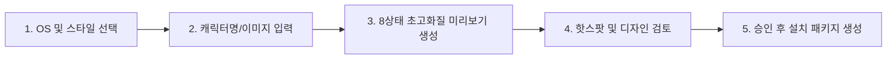

<div align="center">

[简体中文](README.md) · [English](README.en.md) · [日本語](README.ja.md) · [**한국어**](README.ko.md) · [Español](README.es.md)

# 🖱️ Mouse Pointer Theme Maker (마우스 포인터 테마 메이커)

### 최애 캐릭터를 손끝으로. AI로 macOS / Windows 맞춤형 고화질 마우스 커서 테마를 원클릭 제작.

크리에이터와 데스크톱 꾸미기 애호가를 위한 오픈소스 AI Skill. 캐릭터 이름, 오리지널 마스코트 또는 참고 이미지를 입력하면 3대 아트 스타일, 실용적인 8대 기능 상태의 초고화질 마우스 커서 테마를 생성하여 macOS (.cape) 및 Windows (.cur) 네이티브 형식으로 완성합니다.


<br/>


<br/>

활용 분야: **데스크톱 꾸미기, 캐릭터/IP 굿즈 제작, 스트리머 전용 커서, 특별한 디지털 선물**.

</div>

---

## ✨ 핵심 기능

- 🎨 **3가지 독창적인 아트 스타일**: `retro-pixel`(레트로 픽셀), `chibi-anime`(SD 애니메이션), `abstract-expression`(추상 표현).
- 🎯 **일상적인 8대 기능 상태 완벽 커버**: 일반 선택, 텍스트 입력, 링크 클릭, 사용 불가, 처리 중, 화면 이동, 가로 조절, 세로 조절.
- 🖼️ **2440×1388 초고화질 미리보기**: "먼저 확인하고 만족한 뒤 패키징" 원칙. 320×320 원본 리소스로 렌더링되며 붉은 십자가로 실제 클릭 핫스팟(Hotspot) 표시.
- 💻 **macOS & Windows 네이티브 듀얼 플랫폼 지원**:
  - **macOS**: `.cape` 테마 패키지 생성 (Mousecape SwiftUI 완벽 호환, 51개 시스템 Identifier 자동 확장).
  - **Windows**: 15개 표준 `.cur` 파일 및 원클릭 설치/복구 PowerShell 스크립트 제공 (관리자 권한 불필요).

---

## 🎬 테마 갤러리 (Theme Showcase)

### 🎮 카오자이 · 레트로 픽셀 (Retro Pixel)
<div align="center">
  
</div>

### 🐻 카오메이 · SD 애니메이션 (Chibi Anime)
<div align="center">
  
</div>

### 🎭 궁중 드라마 · 추상 표현 (Abstract Expression)
<div align="center">
  
</div>

---

## 🛠️ 제작 워크플로우



---

## 📦 설치 및 실행

```bash
git clone https://github.com/kaomei/mouse-pointer-theme-maker.git
cd mouse-pointer-theme-maker

# Codex
cp -R . "${CODEX_HOME:-$HOME/.codex}/skills/mouse-pointer-theme-maker"

# Antigravity / Gemini CLI
cp -R . ~/.gemini/config/skills/mouse_pointer_theme_maker
```

---

## ⚠️ 면책 조항 및 안내 (Disclaimer)

1. **비공식 프로젝트**: 본 프로젝트는 오픈소스 프롬프트 엔지니어링 툴이며, 언급된 애니메이션/게임/기업과 상업적 제휴 관계가 없습니다.
2. **지적재산권 귀속**: 예시 캐릭터 및 디자인의 권리는 원작자에게 귀속됩니다.
3. **사용 범위**: 개인 학습, 연구 및 비상업적 데스크톱 커스터마이징에 활용하시기 바랍니다.

---

## 🤝 기여 안내

새로운 테마 PR 및 개선 제안을 환영합니다!

이 프로젝트가 마음에 드셨다면, **Star ⭐️를 눌러 kaomei(烤妹儿)를 응원해주세요!**

## 📄 라이선스

[MIT License](LICENSE) © 2026 [kaomei](https://github.com/kaomei)
