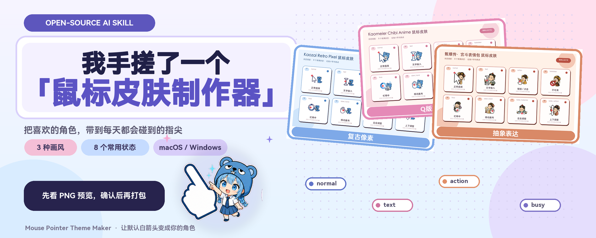
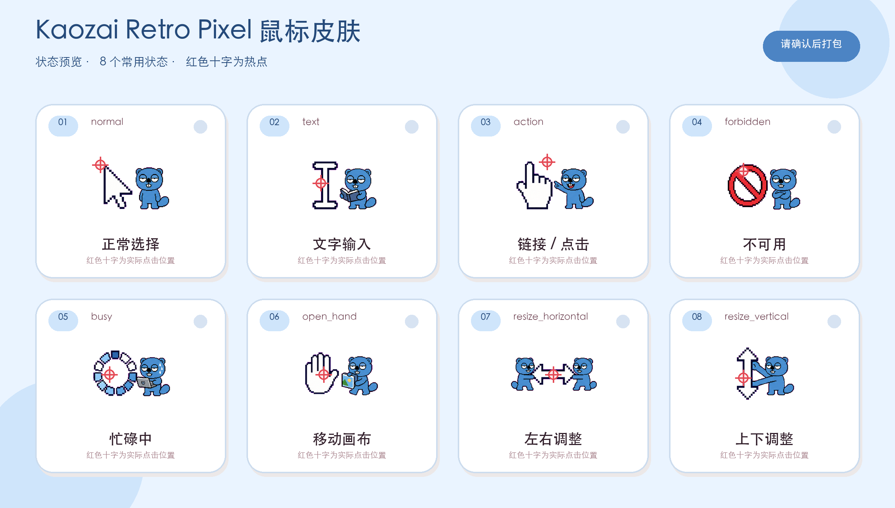
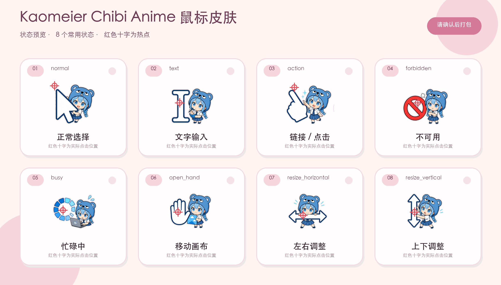
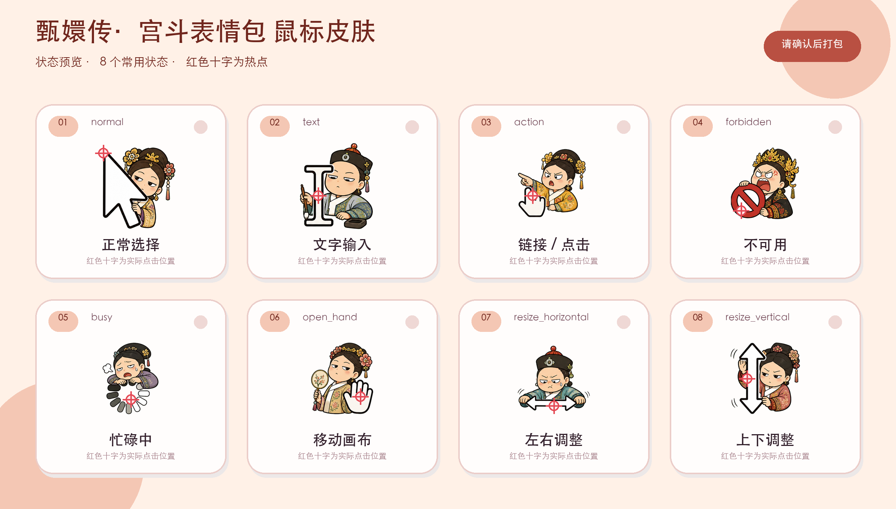
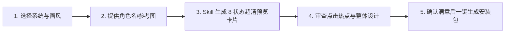

<div align="center">

[**简体中文**](README.md) · [English](README.en.md) · [日本語](README.ja.md) · [한국어](README.ko.md) · [Español](README.es.md)

# 🖱️ Mouse Pointer Theme Maker (鼠标指针主题制作器)

### 把心爱的角色带到指尖，用 AI 一键定制 macOS / Windows 专属高颜值鼠标皮肤

一款面向创作者与个性化爱好者的开源 AI Skill。只需提供角色名、原创吉祥物或一张参考图，即可一键生成 3 大精美画风、8 大常用功能状态的超清鼠标光标主题，支持 macOS (.cape) 与 Windows (.cur) 原生双端独立交付，所见即所得。


<br/>



<br/>

适用于：**电脑桌面美化、二次元/IP周边定制、个人专属电脑皮肤、主播/博主特色鼠标、送朋友的独特数码礼物**。

</div>

---

## ✨ 核心亮点 (Features)

- 🎨 **3 大独特艺术画风**：`retro-pixel`（复古像素）、`chibi-anime`（Q版二次元）、`abstract-expression`（抽象表达），真正让角色融入鼠标交互功能，绝非生硬将图片贴在箭头上。
- 🎯 **8 大高频功能状态全覆盖**：常规选择、文字输入、链接点击、禁止操作、后台忙碌、移动抓手、水平调整、垂直调整，全方位覆盖日常使用场景。
- 🖼️ **2440×1388 超清卡片预览**：坚持“先看预览，满意后再打包”的原则，320×320 原始高分辨率素材渲染，清晰标注红色十字点击热点（Hotspot），所见即所得。
- 💻 **macOS & Windows 原生独立交付**：
  - **macOS**：一键生成 `.cape` 主题包，自动智能映射扩展至 51 个系统底层精准 Identifier，完美适配 Mousecape SwiftUI。
  - **Windows**：一键生成 15 个标准 `.cur` 光标文件，附带当前用户一键安装与恢复脚本（只写入 `HKCU`，安全干净，无需管理员权限）。
- 🔍 **精确热点对齐与安全边距保护**：热点严密落在箭头尖端、工字中心、食指尖、掌心或缩放箭头交叉点，内置自动透明边缘质检，杜绝裁切毛边与杂色残留。

---

## 🎬 精选主题画廊 (Theme Showcase)

### 🎮 烤仔 · 复古像素风 (Retro Pixel)

真正的 16/32 位复古游戏像素重构，清晰利落的功能轮廓与色彩层次，完美还原烤仔标志性的慵懒困倦神态。

<div align="center">
  
</div>

### 🐻 烤妹儿 · Q 版二次元风 (Chibi Anime)

精致灵动的 Q 版二次元角色体系，围绕标志性蓝色熊帽、萌趣大表情与清晰易辨的功能符号精心设计。

<div align="center">
  
</div>

### 🎭 宫斗表情包 · 抽象表达风 (Abstract Expression)

夸张的动作形变、视觉隐喻与表情包节奏，生动展现抽象风格的张力与幽默感（绝不仅限于恶搞）。

<div align="center">
  
</div>

> 💡 *注：预览图中的红色十字仅用于直观展示点击热点位置，安装后的实际鼠标图案中绝不会出现。*

---

## 🎨 3 大艺术画风解析 (Art Directions)

| 画风标识 | 中文名称 | 视觉特征与表现方式 | 推荐适用主题 |
|---|---|---|---|
| `retro-pixel` | **复古像素风** | 16/32 位像素感、坚实利落的 1–2px 轮廓线、鲜艳纯净色块，无模糊渐变 | 游戏角色、复古 Mascot、极客风格、复古数码 |
| `chibi-anime` | **Q 版二次元风** | 萌系大表情、圆润头身比、干净明快线稿、统一的角色服饰配件 | 动漫人物、原创萌宠、二次元 IP、可爱插画 |
| `abstract-expression` | **抽象表达风** | 夸张形变、视觉隐喻、超现实幽默、民俗插画感或表情包神态 | 热门梗图、影视名场面、魔性角色、创意概念 |

---

## 🎯 8 大核心功能状态说明 (Practical States)

| 状态标识 | 功能说明 | 视觉表现重点 | 推荐热点位置 (Hotspot) |
|---|---|---|---|
| `normal` | 普通选择 | 默认箭头，角色位居箭头后方或右下 | 箭头左上角最尖端 (Tip) |
| `text` | 文本输入 | 工字光标 (I-beam)，便于文字精确定位 | 工字竖线正中心 (Center) |
| `action` | 链接/按钮点击 | 伸出食指的小手或指示动作 | 伸出食指的最尖端 (Fingertip) |
| `forbidden` | 禁止/不可用 | 叉号、禁止符号或角色做出拒绝姿态 | 标识正中心或左上尖端 |
| `busy` | 后台处理/等待 | 沙漏、转圈或角色困倦/打瞌睡动态 | 视觉重心或中心 |
| `open_hand` | 拖拽/移动画布 | 张开的手掌或抓取动作 | 手掌正中心 (Palm center) |
| `resize_horizontal` | 左右水平缩放 | 双向水平箭头指示 | 双向箭头正中心 (Cross center) |
| `resize_vertical` | 上下垂直缩放 | 双向垂直箭头指示 | 双向箭头正中心 (Cross center) |

---

## 🛠️ 创作工作流 (Workflow)



1. **明确平台与画风**：选择你的电脑系统（macOS 或 Windows 10/11）以及心仪的艺术画风。
2. **输入角色灵感**：提供角色名称、原创吉祥物描述，或上传一张正面清晰参考图。
3. **获取高清预览**：Skill 自动生成包含全部 8 个状态的高清 PNG 效果图（附带热点标记）。
4. **审查与调整**：检查角色神态与点击热点位置，可随时要求微调。
5. **打包与安装**：确认满意后，Skill 为所选平台生成专属安装包并提供保姆级安装教程。

---

## 新版预览排版 · 1.1.1

默认采用粗黑体标题、放大的角色插画、轻阴影卡片与统一热点说明。多角色主题可显示「角色名＋中文状态」，英文标识为辅助信息。预览为 2440×1600 PNG，优先使用同画布的高清原稿；字体自动适配 macOS、Windows 或 Linux，长标题自动缩小避免遮挡。

## 📦 安装与使用 (Installation & Quick Start)

### 1. 安装 Skill 至你的 AI 环境

克隆本项目仓库：

### 使用前先检查

Skill 提供创作流程和打包脚本，**不会自动开通生图能力**。你的 Codex 会话需要可用的图片生成工具，支持参考图输入和图片文件输出；仅接入聊天模型或兼容 Responses API 的服务不代表可以生图。缺少工具时，Skill 会明确停止，不用原图贴纸或脚本绘图冒充生成效果。

本次修正版为 **1.1.1**。它逐状态重绘，以第一张合格作品固定画风；工具允许时按 2–3 张小批量并行，失败只重做对应状态，已完成文件可继续使用。出图耗时取决于生图服务，无法保证固定时长。不同模型的审美效果也可能不同，示例图不代表每次都会生成相同作品。

本地缩放、预览和打包需要 Python 3 与 Pillow：`python3 -m pip install Pillow`；Windows 可使用 `py -3 -m pip install Pillow`。

```bash
git clone https://github.com/kaomei/mouse-pointer-theme-maker.git
cd mouse-pointer-theme-maker
```

如果之前装过旧版本，不要直接把新旧文件夹合并。先把 `~/.codex/skills/mouse-pointer-theme-maker` 移到 skills 目录之外备份，再复制新版本；这样不会残留旧的 Skill 规则。重新启动 Codex 后，确认 Skill 文件中包含“eight separate image-generation jobs”和“HTTP 413 Payload Too Large”。

如果旧版名为 `macos-cursor-skin`，也应将其移到 skills 目录之外备份，避免两个版本同时触发。**不要只在 skills 内改名备份**：备份目录仍含 `SKILL.md` 时可能继续被发现。Windows 的技能目录通常是 `%USERPROFILE%\.codex\skills`，更新时同样先把旧版移到该目录之外，再复制新版本。检查实际加载的 `SKILL.md` 包含版本 `1.1.1`。

复制到对应的 skills 目录：

```bash
# Codex
cp -R . "${CODEX_HOME:-$HOME/.codex}/skills/mouse-pointer-theme-maker"

# Antigravity / Gemini CLI
cp -R . ~/.gemini/config/skills/mouse_pointer_theme_maker
```

### 2. 在对话中随时唤醒

重启 AI 工具，然后可以这样说：

```text
使用 $mouse-pointer-theme-maker。
电脑：macOS
画风：retro-pixel
主题：把我上传的蓝色原创吉祥物参考图做成一套完整鼠标皮肤。
```

---

## 💻 平台交付规格与安装指引 (Platform Delivery)

### 🍏 macOS 平台交付
- **交付产物**：打包为标准的 `.cape` 主题包文件。
- **使用方式**：配合开源工具 [Mousecape SwiftUI Releases](https://github.com/sdmj76/Mousecape-swiftUI/releases) 使用，将 `.cape` 文件拖入 Mousecape 即可一键 `Apply` 应用。
- **底层覆盖**：自动将 8 个核心设计智能扩展映射为 51 个 macOS 系统级光标 Identifier，体验丝滑完整。

### 🪟 Windows 平台交付
- **交付产物**：打包为 15 个标准的 `.cur` 光标文件，并附带 `install-current-user.ps1` 和 `restore-default.ps1`。
- **使用方式**：右键 `install-current-user.ps1` 选择 **使用 PowerShell 运行 (Run with PowerShell)** 即可秒级生效；随时运行 `restore-default.ps1` 可一键恢复系统默认鼠标。
- **安全保障**：仅写入当前用户的 `HKCU\Control Panel\Cursors`，无需管理员权限，不篡改系统全局文件。

---

确认后的图案会打包为 15 个 `.cur` 文件；每个文件优先包含 32×32 与 64×64 两个清晰尺寸，并提供当前用户安装脚本和恢复脚本。安装脚本只写入 `HKCU\Control Panel\Cursors`，不需要管理员权限。

## 🛡️ 质量保证与安全规范 (Quality Guarantees)

- 🔍 **超清渲染保障**：所有预览图均达到 2440×1388 或更高分辨率，卡片源自 320×320 高清素材，杜绝低清图标模糊拉伸。
- 🎯 **像素级热点对齐**：经过严格几何校验，确保每次点击都精准无误。
- 🧼 **安全边距与透明通道**：自动化脚本严审素材边缘，坚决拒绝裁切残留、相邻格混入与杂线。
- 🔒 **隐私与安全隔离**：用户提供的素材、生成的私有安装包不入公开仓库，Windows 安装脚本无需提升权限。

---

## 📁 仓库结构 (Repository Structure)

- 运行记录 `generation-record.json` 会记录版本、实际生图工具、状态文件和审阅结果，便于排查“没有图片”和“效果不同”；不会记录密钥或整段聊天。
- 文件测试能验证尺寸、热点和打包格式，不能代替审美检查，也不能证明所有第三方生图服务兼容。

- 有些软件会绘制自己的鼠标，或始终调用普通箭头。
- 忙碌、不可用、移动和拉伸状态出现频率取决于应用。
- 角色名和参考图只是创作需求，不代表官方授权或合作。
- 只能提交或公开自己有权使用的图片。
```text
mouse-pointer-theme-maker/
├── agents/       # Codex UI 交互元数据
├── assets/       # Manifest 主题清单模板与封面资源
├── examples/     # 经典精选主题超清预览画廊
├── references/   # 画风、状态映射、安装教程与平台规范文档
├── scripts/      # 预览生成、Cape 打包、Windows Cur 转换与校验工具集
├── tests/        # 契约与功能单元测试
└── SKILL.md      # Skill 核心调度规范
```

---

## ⚠️ 免责声明与版权提示 (Disclaimer)

1. **非官方声明**：本项目（`mouse-pointer-theme-maker`）为一个开源的 AI 提示词工程与主题制作工具，**与文中所提及的任何动漫、游戏公司、版权方或品牌官方均无任何商业合作、赞助或官方关联**。
2. **知识产权归属**：示例中涉及的角色名称、动漫形象及其衍生设计之所有知识产权与商标权，均归属于各自原始版权持有方所有。
3. **用途限定**：本 Skill 生成的主题仅供个人学习、技术研究、AI 艺术探索及**非商业性质的个人桌面美化**使用。请勿将受版权保护的角色素材用于商业化盈利或侵权分发，使用者需自行承担相关法律责任。

---

## 🤝 欢迎贡献 (Contributing)

欢迎提交 Issue 或 Pull Request 分享你制作的精美光标主题或提出优化建议！

提交前请确保运行并通过本地测试：

```bash
python3 -m unittest discover -s tests -v
```

如果这个项目帮你的电脑换上了心爱的鼠标皮肤，**请给项目点一个 ⭐️ Star 支持烤妹儿！**

---

## 📄 开源协议 (License)

本项目源码遵循 [MIT License](LICENSE) © 2026 [kaomei](https://github.com/kaomei)。

示例中的角色图案与设计版权归原作者所有，仅用于功能与效果展示，不构成官方产品或商业授权背书。
